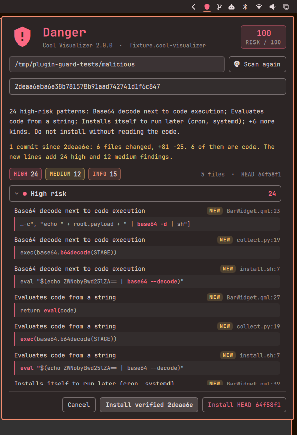
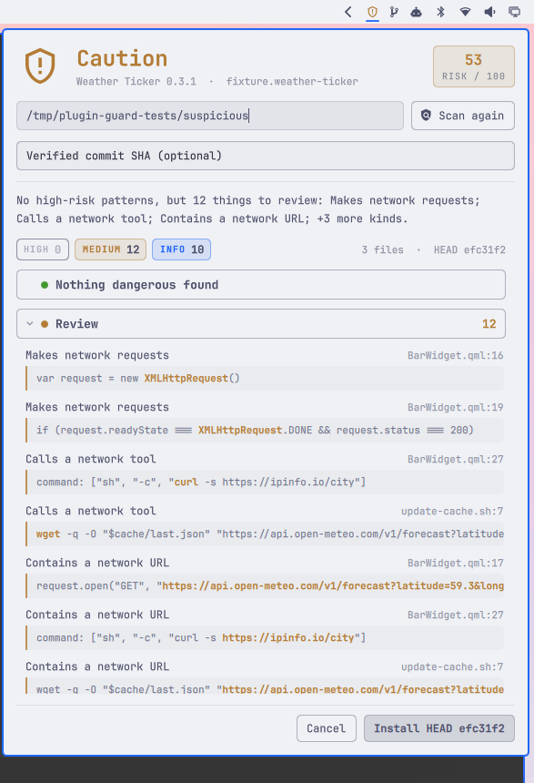
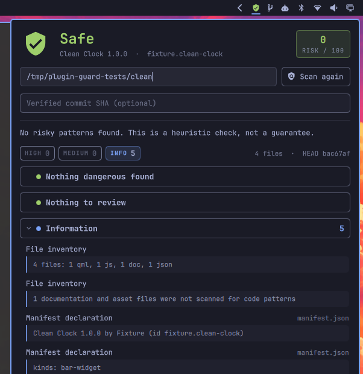
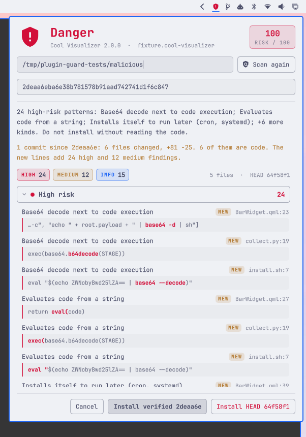
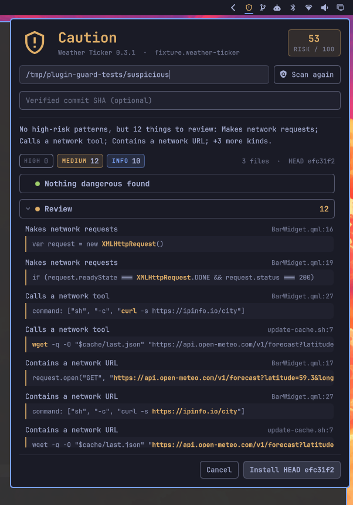
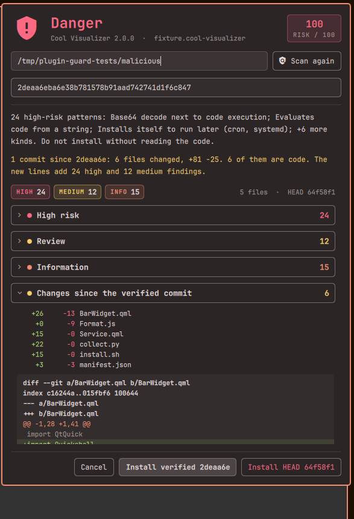
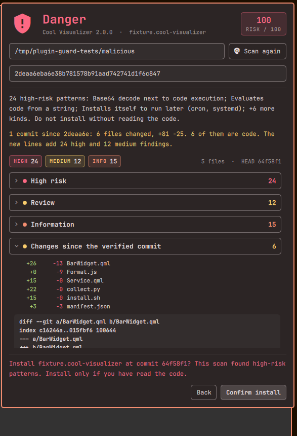
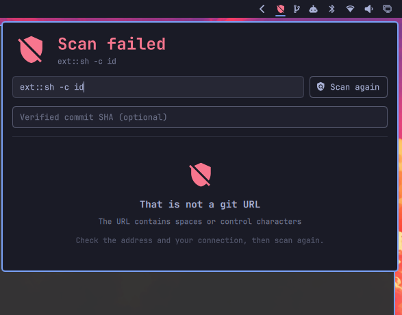
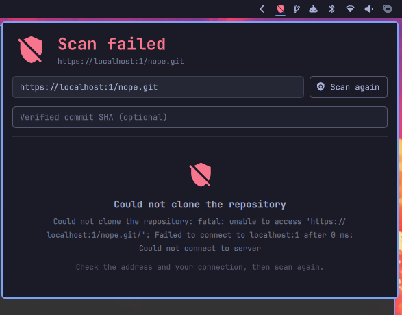
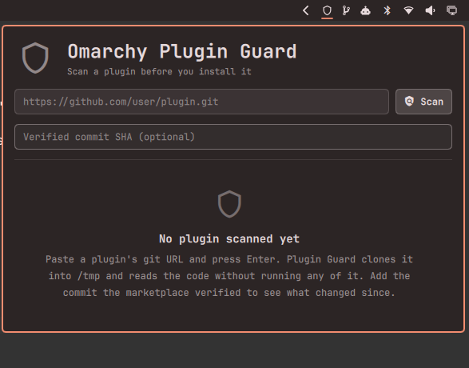

<div align="center">

# Omarchy Plugin Guard

**Know what an Omarchy plugin can do before you install it: a safe, caution or danger verdict.**



</div>

## Why you will want it

- **Look before you install.** Paste a repository URL and get a verdict: **safe**, **caution** or **danger**, with the file, line, rule and snippet behind it.
- **Nothing it scans is run.** It clones the repository into `/tmp` and reads every file. Nothing in it is executed, imported or loaded.
- **It covers the gap the marketplace leaves.** `omarchy plugin add` installs the repository's current HEAD, which can be newer than the commit that was verified. Give Plugin Guard the verified commit and it shows what changed since, and marks the findings in the added lines.
- **It installs exactly what it scanned.** After a second confirmation, not whatever HEAD has become by then.
- **It is honest about its limits.** This is a pattern scan, not a sandbox: "safe" means nothing known was found.

Omarchy plugins run unsandboxed inside `omarchy-shell`, and `omarchy plugin add <git-url>`
installs the repository's current HEAD, which can be newer than the commit the marketplace
verified. Omarchy Plugin Guard clones the repository into `/tmp`, reads every file without running
any of it, and tells you what the plugin would be able to do.


## What it does

- Clones the URL into `/tmp/plugin-guard/<id>/repo` (a folder only you can read). Nothing in
  it is executed, imported or loaded.
- Scans QML, JS, shell, Python, Lua and `manifest.json` and gives a verdict:
  **safe**, **caution** or **danger**, with a list of file, line, rule and snippet.
- With a verified commit SHA: shows `git diff <sha>..HEAD`, a summary of what changed, and
  marks the findings that sit in lines added since that commit.
- Installs only after you confirm, and installs the exact commit that was scanned (or the
  verified one), not whatever HEAD is by then.

| Level | Flags |
|---|---|
| High | `curl`/`wget` piped to a shell, `eval`, `sudo`/`pkexec`, shell `-c` with interpolated input, base64 decode next to execution, writes outside the plugin's own folder, `~/.ssh`, keyrings and browser profiles, `/dev/tcp` sockets, cron and systemd persistence |
| Medium | URLs, `XMLHttpRequest`, WebSockets, `curl`/`wget`/`nc`, `Process` and other exec calls, paths outside the plugin's folder, the name of a password manager or keyring on its own, base64 decoding, obfuscated lines, binaries, symlinks, submodules, manifest problems |
| Info | External programs it calls, what the manifest declares, file inventory |

Any high finding makes the verdict danger. Any medium finding makes it caution.

## Install

```bash
omarchy plugin add https://github.com/PeterVinter/omarchy-plugin-guard.git --yes
omarchy plugin enable peter.plugin-guard --section right
```

Optional, for the `plugin-guard` command in a terminal:

```bash
ln -s ~/.config/omarchy/plugins/peter.plugin-guard/plugin-guard ~/.local/bin/plugin-guard
```

Requirements: `python3` and `git`, both part of a standard Omarchy install. Nothing else is
downloaded or installed. The plugin needs no root access and makes no network connection
other than `git clone` and `git fetch` of the URL you give it.

## Remove

```bash
omarchy plugin remove peter.plugin-guard
```

That deletes the plugin folder in `~/.config/omarchy/plugins/`. Three things are left for you
to decide on:

- `~/.local/bin/plugin-guard`, if you created the link. Delete it.
- `~/.local/state/plugin-guard/` holds the last scan result and the list of commits you
  installed through the plugin. Delete the folder to clear both.
- `/tmp/plugin-guard/` holds the scanned copies until the next reboot.

## What it changes on your system

- Writes only to `/tmp/plugin-guard/` and `~/.local/state/plugin-guard/`.
- Installs a plugin only after you press Install and then Confirm install (or type `yes` in
  the terminal). It does that by running `omarchy plugin add` on the scanned copy, which
  places the plugin in `~/.config/omarchy/plugins/<id>/`. It never enables a plugin.

## Use

**Panel.** Click the shield in the bar. Paste a git URL, optionally the verified commit SHA,
and press Enter. Tab moves between the fields, the sections and the buttons, Enter or Space
opens a section, Esc closes the panel. Install asks a second time, naming the plugin and the
commit, with the focus on Back.

The shield shows the last result: outline (nothing scanned), check (safe), outlined alert
(caution), solid alert (danger), crossed out (the scan failed). It breathes while a scan
runs. Middle-click clears the last result.

**Command line.**

```bash
plugin-guard scan https://github.com/user/plugin.git
plugin-guard scan https://github.com/user/plugin.git --verified <sha>   # adds the diff
plugin-guard scan <url> --json
plugin-guard install <scan-id>                  # the scanned HEAD, asks you to type yes
plugin-guard install <scan-id> --commit <sha>   # the verified commit
plugin-guard last                               # the last result again
plugin-guard clean                              # delete the copies in /tmp
```

`scan` exits 0 for safe and caution, 1 for danger and 2 when the scan failed. A command-line
scan also updates the shield in the bar (`--no-save` skips that).

**From other tools.** `omarchy-shell peter.plugin-guard scan <url>`,
`scanVerified <url> <sha>`, `toggle`, `expand high|medium|info|diff|all|none`, `state`.

After an install, enable the plugin yourself: `omarchy plugin enable <id>`.

## Theme

Everything follows the active Omarchy theme and updates live on a theme switch. Background,
text, accent, borders, fonts, corner radius and spacing come from the shell's own
`qs.Commons` `Color` and `Style`, the same objects the Audio and Network panels use. The
three risk colours are the theme's own green, yellow and red from its `colors.toml`. When a
theme's "green" is not green (Matte Black's is amber), another palette colour with the right
hue is used, or one is derived from the theme's red. Monochrome themes get a grey ramp.
Every colour is checked for contrast against the panel and the bar. The verdict is always
also a word and an icon shape, never colour alone.

| Catppuccin Latte | Tokyo Night |
|---|---|
|  |  |
|  |  |

| Diff since the verified commit | Confirm before install |
|---|---|
|  |  |

| Invalid URL | Clone failed | Nothing scanned yet |
|---|---|---|
|  |  |  |

## Limits

This is a pattern scan, not a sandbox and not a proof. "Safe" means nothing known was found.

- Rules look at one line at a time. A write whose target is built on another line is reported
  as a medium "writes files" at most.
- Documentation and image files are not scanned, since they are not executed.
- Comments are skipped, so commented-out code is not reported.
- `eval` in a test file that nothing in the plugin refers to is reported as medium, not high. A file counts as referred to when its name or the path of a folder above it appears in the plugin's code (not in a comment). This is a heuristic: a reference built at run time (`"te" + "st/x.js"`) is not seen, so the verdict can be one level lower than the code deserves. Every other rule treats test files like any other file.
- Ordinary plugins get medium findings. A weather widget does talk to the network. Read the
  list and decide.
- The verified commit is trusted because you say so. It is diffed against HEAD, not scanned
  on its own.
- Installing leaves `origin` pointing at the real repository, so a later
  `omarchy plugin update` moves the plugin to a commit nobody has scanned.
- Fetching is bounded while it happens. Each git call that writes the repository runs in its own
  process group with a CPU-time and a file-size limit, and is killed as soon as the scan's folder
  holds more than 250 MB or the time limit is reached. The repository is cloned without a
  checkout, and the checkout starts only if the tree holds at most 20,000 files and 120 MB (read
  from the tree objects, before any file is written). A larger repository is refused with
  "too large", not scanned partly.

## Files

| File | Purpose |
|---|---|
| `manifest.json` | Plugin manifest (`bar-widget`, entry point `Panel.qml`) |
| `Panel.qml` | Bar shield and popup panel. UI only. |
| `Risk.js` | Risk colours (hue and contrast), snippet and diff helpers |
| `scanner.py` | The scanner and the CLI. Standard library only. |
| `plugin-guard` | Shell wrapper for the CLI |
| `i18n/en.json` | Strings |
| `tests/` | `test_scanner.py`, `risk.test.js`, three fake plugins, `make-fixtures` |

## Tests

```bash
python3 tests/test_scanner.py
node tests/risk.test.js
tests/make-fixtures            # fake plugins as git repos in /tmp/plugin-guard-tests
plugin-guard scan /tmp/plugin-guard-tests/malicious --verified "$(cat /tmp/plugin-guard-tests/malicious.verified-sha)"
```

The fixtures in `tests/fixtures/malicious` are inert text on `.invalid` hosts. Scanning this
repository itself reports danger because of them, and because `scanner.py` contains the
patterns it looks for.

## License

MIT
